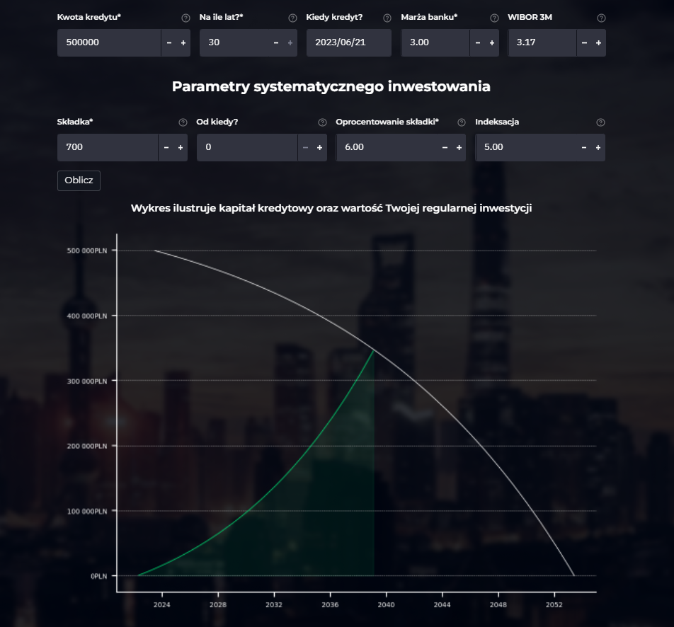

# Mortgage Calculator – FinancialMill

An interactive mortgage calculator I built in Python (Streamlit) for the **FinancialMill.pl** finance blog. It is not an ordinary tool for calculating credit costs. It is closer to an interactive presentation that walks the user through how a mortgage works and helps them make an informed choice about how to reduce its cost.



> The app was deployed on Heroku (`kalkulator-financialmill.herokuapp.com`) and was available to registered blog users. Both the blog and the app are now offline because the hosting was not renewed; the code and screenshots are kept here.

## What it does

The calculator guides the user through several topics, chosen from the sidebar:

| Section | What it shows |
| --- | --- |
| **Zacznij tutaj** (Start here) | Introduction and how to use the calculator |
| **Parametry kredytu** (Loan parameters) | Instalment, total cost of the loan and repayment schedule for a given amount, term, bank margin and WIBOR 3M |
| **Stopy procentowe vs rata** (Interest rates vs instalment) | Impact of WIBOR 3M on the instalment and total cost, based on historical WIBOR data (2000–2022) and average bank margins |
| **Nadpłacanie kredytu** (Overpaying the loan) | Savings from overpayments, taking into account when overpayments start and their indexation |
| **Bilansowanie kredytu** (Balancing the loan) | The same scenario, but instead of overpaying, the money is invested regularly and the loan is paid off in one go once the investment covers the remaining capital |
| **Kredyt spłaca się sam?** (Can the loan pay itself off?) | How much, for how long and at what target return to invest so that portfolio dividends cover the loan instalment |

Every section links to an article I wrote on the blog, and tooltip icons explain the basic terms, so users understand what they are looking at, not just the numbers.

## Access and login system

The calculator was a premium tool. Users signed up on the blog's premium page, which I built in **PHP, HTML/CSS and MySQL**:

- sign-up by email only, with email verification
- reCAPTCHA and terms-of-service consent
- after logging in: access to the calculator and a discount on the blog's ebook
- users could delete their account at any time


## Tech stack

- **Python** – Streamlit, pandas, NumPy, numpy-financial, Matplotlib, seaborn
- **Data** – historical WIBOR 3M rates (`wibor3m.csv`) and average mortgage margins in Poland (`Marza_kredytow_mieszkaniowych2.csv`)
- **Deployment** – Heroku (`Procfile`, `setup.sh`)
- **Login system** – PHP, MySQL, reCAPTCHA

## Project structure

```
MyApp.py                 # Streamlit app: layout, sidebar navigation, sections
KredytNormalnie.py       # Parametry_kredytu class – loan schedule, overpayment and investment calculations, charts
wibor3m.csv              # Historical WIBOR 3M rates
Marza_kredytow_...csv    # Average bank margins on mortgages
styles.css, bootstrap*   # Custom styling
images/                  # Logo, icons, backgrounds
docs/                    # README screenshots
```

## Running locally

The app was written for Python 3.8/3.9 and Streamlit 0.85.

```bash
pip install -r requirements.txt
streamlit run MyApp.py
```

The UI is in Polish. Activation code: `FinancialMill2022`.

## Configuration

Database credentials are read from environment variables. Copy `.env.example` to `.env` and fill in the values (on Heroku, set them as Config Vars).

## Notes

I wrote the calculation logic in about three days. Designing the sections, writing the explanations and articles, and deploying the app took several months.

I chose Streamlit because it is easy to use and builds the UI for you. In practice, whenever I wanted something to work my own way, especially when capturing user input, I ran into its limitations, and working around them and fixing deployment issues took more time than the framework saved.
